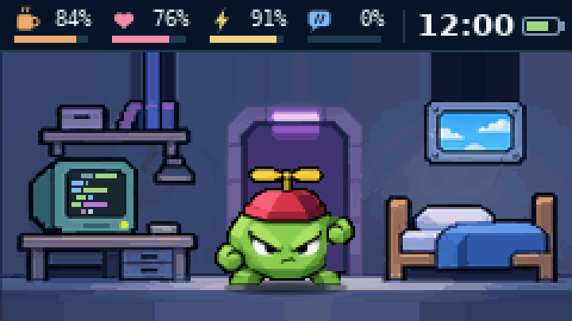
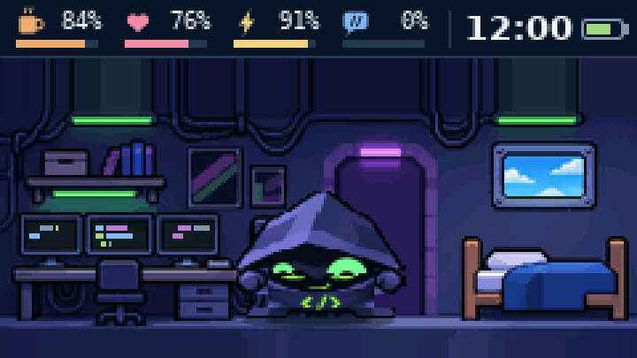
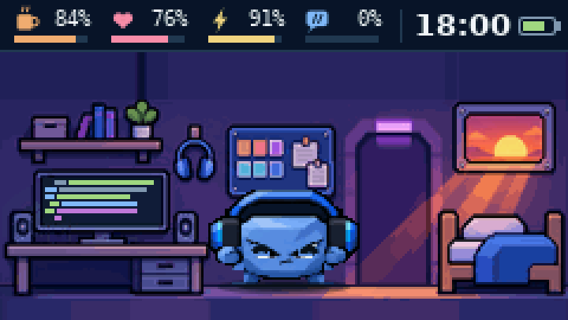
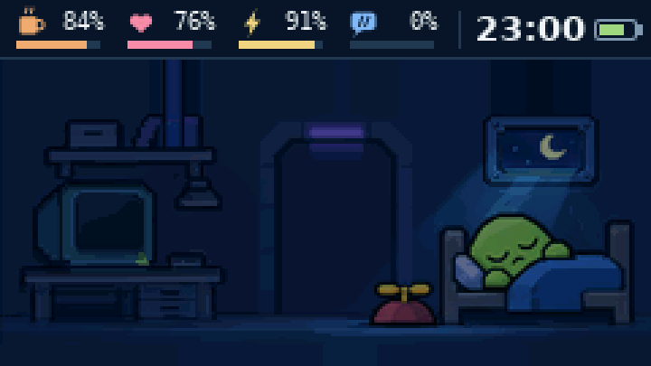
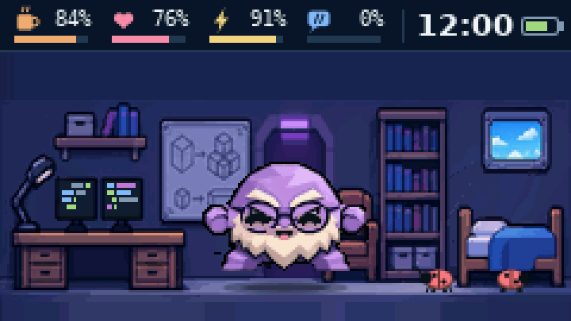
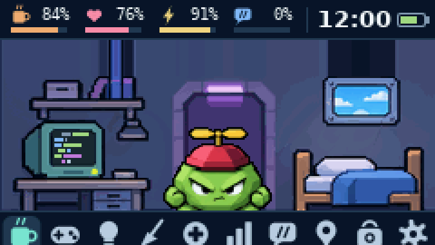
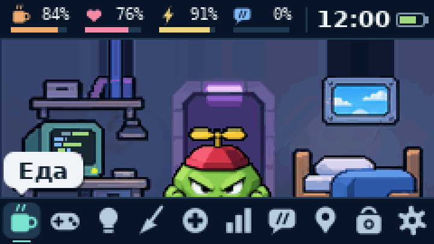
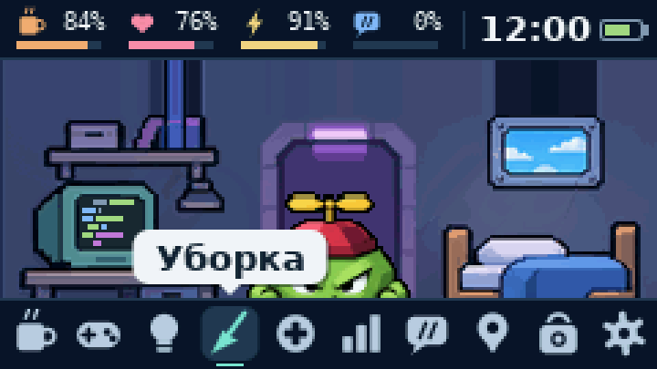
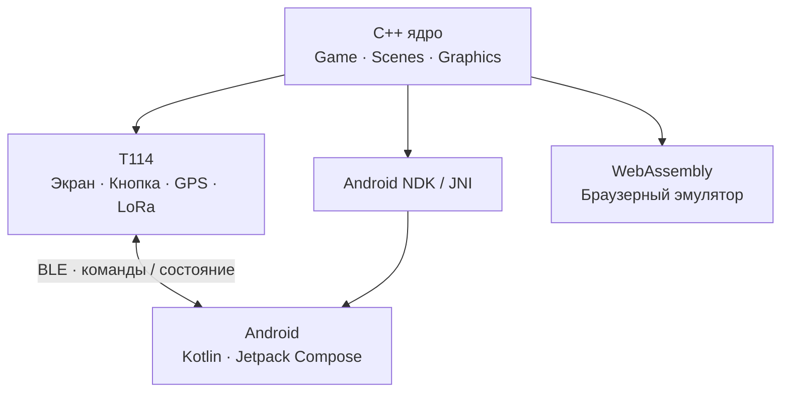

<div align="center">

**BIT · HELTEC T114 · OPEN-SOURCE VIRTUAL PET**

# 🐣 БИТ

### Не заводи питомца. Скомпилируй его.

**Маленький цифровой персонаж с большим характером.**  
Он живёт на настоящей плате, спит по расписанию, любит кофе, ловит баги, взрослеет и иногда требует провести код-ревью.



<sub>Настоящий кадр из симулятора прошивки 0.41 · экран 240 × 135 · изображение увеличено без сглаживания</sub>

<br>

[](https://github.com/TVSrv/bit-t114/actions/workflows/build.yml)
[](LICENSE)


**[🎮 Посмотреть игру](#-как-живёт-бит)** · **[🖼 Галерея 0.41](#-настоящие-кадры-041)** · **[📲 Android](#-бит-на-телефоне)** · **[🚀 Установка](#-установка-за-несколько-шагов)** · **[🛠 Для разработчиков](#-внутри-проекта)**

</div>

---

## 👋 Знакомьтесь: ваш новый сосед по рабочему столу

Представьте, что маленький программист поселился не в окне браузера, а в отдельном устройстве. У него свой рабочий стол, кровать, настроение, привычки и особое отношение к ошибкам. У него нельзя просто спросить «как дела?» — иногда нужно покормить его пиццей, иногда убрать баги, а иногда просто дать выспаться.

**«Бит» — тамагочи для Heltec Mesh Node T114**, в котором привычный уход за виртуальным питомцем соединён с эстетикой разработки ПО. Вместо обычных монет и конфет — ещё и компиляция, отладка, деплой, пинг, код-ревью и достижение «Коллекционер».

Это **самостоятельная игра на физическом устройстве**, а не экранная заставка телефона. Android-приложение дополняет её: позволяет следить за Битом, управлять действиями и обновлять прошивку по Bluetooth.

**11 форм эволюции** · **6 мини-игр** · **5 типов характера** · **18 достижений**

## 🌱 Как живёт Бит

### ☕ Утро. Снова пора что-то компилировать

Бит просыпается, осматривает комнату и возвращается к компьютеру. Но даже цифровому программисту нужно следить за **сытостью, настроением, энергией и дисциплиной**. Кофе взбодрит, пицца накормит, а печенье поможет поднять настроение.



*Хакер в своей комнате — настоящий кадр симулятора прошивки 0.41.*

### 🌇 Вечер. Пора подвести итоги

Свет в комнате меняется вслед за игровыми часами: **рассвет, утро, день, закат, вечер и ночь**. Вместе с взрослением питомца изменяется и его окружение. Бит может радоваться победе, скучать, заболеть или потребовать внимания.



*Мидл в вечерней мастерской.*

### 🌙 Ночь. Даже программисты должны отдыхать

У каждой формы собственный распорядок сна. Когда Бит засыпает, он устраивается в кровати, а комната погружается в полумрак. Состояние питомца сохраняется во флеш-памяти устройства.



*Джун спит. Без наложенных макетов или сторонних иллюстраций.*

**Уход влияет на будущее.** Питомец может быть **Обжорой, Непоседой, Соней, Умником или Спокойным**. Один лучше учится на код-ревью, другой быстрее восстанавливает силы, третий чаще просит еды.

[Подробнее о характере, возрасте и эволюции →](docs/GAMEPLAY.md)

## 🧬 От Hello World до Нейросети

Бит не остаётся одним и тем же персонажем. Сначала он — маленькая **Компиляция**, затем появляется **Hello World**, потом **Джун**. Дальше его судьба зависит от возраста и ваших решений.

**Мидл, Фрилансер, Сеньор, Архитектор, Хакер, Легаси, Нейросеть и даже Призрак** — всего в игре одиннадцать форм. Это не просто смена имени: у форм различаются внешний вид, окружение, поведение и режим дня.

> **Эволюция — не линейная шкала опыта.** Качество ухода, дисциплина и ошибки могут изменить следующий этап. У Бита есть история поколений и наследуемые особенности.

<details>
<summary><b>Посмотреть, как работает развитие</b></summary>

- **Компиляция → Hello World:** после 10 минут игрового времени.
- **Hello World → Джун:** после 12 часов.
- **Джун:** через 7 суток становится Мидлом либо Фрилансером в зависимости от ухода.
- **Мидл / Фрилансер:** через 10 суток возможны разные взрослые формы.
- **Опытные формы:** спустя ещё 14 суток и при строгих условиях может появиться Нейросеть.

Время каждой стадии отсчитывается от предыдущей эволюции. Часть ветвей и исходов зависит от состояния питомца. [Исходники механики](core/game.cpp).

</details>

## 🎮 Шесть игр вместо бесконечного тапанья

**🪲 Отладка** — поймай баг в правильный момент.  
**🧠 Память** — повтори последовательность битов.  
**🚀 Деплой** — преодолей препятствия во время релиза.  
**📡 Пинг** — попади в момент сетевого отклика.  
**⚙️ Компиляция** — останови сборку в правильной зоне.  
**⚡ Реакция** — нажми после сигнала как можно быстрее.

За игры, заботу, прогулки и новые события Бит получает **монеты и достижения**. В магазине есть аксессуары и темы оформления: от кепки до цилиндра, от Dracula до Matrix.

### 🪲 Баги — это не только метафора

Они действительно появляются на полу. Если их не убирать, Бит начинает беспокоиться.



*Сеньор рядом с багами. Для уборки можно выбрать соответствующее действие в меню.*

## 🖼 Настоящие кадры 0.41

Все снимки ниже получены напрямую из **C++-ядра прошивки 0.41-sync-test** через `Game::render()`. Это не концепт-арт, не скриншоты Android и не фотографии физической платы. Дисплей **240 × 135**; PNG увеличены без сглаживания.

### ⬆️ Меню появляется только тогда, когда нужно

В экспериментальной версии 0.41 нижние **26 пикселей** больше не заняты постоянно видимой панелью. Бит живёт в расширенной комнате, а меню плавно выезжает по кнопке.

**1. Комната без панели**


**2. Меню выдвигается**



**3. Меню полностью открыто**



<details>
<summary><b>Ещё кадр: переключение выделенного значка</b></summary>



</details>

### 🌆 Не только одно и то же помещение

**Мидл вечером**


**Хакер днём**


*Источник снимков: [все восемь PNG](docs/screenshots/) · [метод генерации](docs/SCREENSHOTS.md) · [код генератора](sim/docs_shots.cpp).*

> **О версии:** этот публикационный снимок содержит прошивку **0.41-sync-test** и Android **0.19-test**. Кадры галереи воспроизведены из этого же графического ядра.

## 📲 Бит на телефоне

Физический питомец остаётся главным, но **Android-компаньон** делает уход удобнее.

- **Зеркальный экран.** Android использует тот же код отрисовки на C++, поэтому фигурки и элементы игры не создаются заново на Kotlin.
- **Действия и состояние.** Показатели, кормление, свет, лечение, уборка, история и уведомления доступны со смартфона.
- **Память о питомце.** Резервный код, журнал событий, достижения и статистика развития.
- **Обновления без кабеля.** Встроенная передача Nordic DFU-прошивки через Bluetooth.
- **Связь с устройством.** В экспериментальной связке **T114 0.41 + Android 0.19** телефон получает по BLE положение выдвижного меню и выбранный пункт.

В **Android 0.19-test** предусмотрены вкладки **«Питомец» · «Развитие» · «Устройство»**, а также виджет, фоновая служба и уведомления.

> **О скриншотах Android.** Настоящие снимки интерфейса Android 0.19 пока не опубликованы. Мы не выдаём изображения игры или дизайн-концепты за скриншоты приложения. [Что осталось задокументировать](docs/SCREENSHOTS.md).

## 📡 Две платы могут познакомиться

**LoRa — не просто запасной радиоканал.** Если рядом находится ещё один Бит с включёнными встречами, питомцы могут обнаружить друг друга: на экране появляется гость, которого можно угостить печеньем. В проекте есть также механика дуэлей.

Для прогулок используется GPS L76K: время, движение, места и небольшие задания. Для этого не нужен постоянный внешний сервер игры; состояние и основная логика находятся на T114.

## 🔘 Один экран. Одна кнопка. Целый мир.

**Heltec Mesh Node T114** — компактная плата на **Nordic nRF52840** с дисплеем **ST7789 240 × 135**, радиомодулем **SX1262 / LoRa**, **Bluetooth LE**, **GPS L76K** и светодиодами **WS2812**. Состояние питомца сохраняется во внутренней флеш-памяти.

### Управление в экспериментальной 0.41

- **Короткое нажатие** — открыть меню или перейти к следующему пункту.
- **Долгое (~0,6 секунды)** — выбрать действие.
- **Удержание (~2 секунды)** — вернуться или скрыть меню.

Панель автоматически исчезает после **7 секунд** бездействия.

## 🚀 Установка за несколько шагов

> [!IMPORTANT]
> **Версии этого репозитория:** T114 **0.41-sync-test** + Android **0.19-test**. Это экспериментальная пара, собранная и проверенная автоматическими тестами. Перед прошивкой сохраните код питомца вне приложения. Физическое тестирование разных устройств ещё не завершено.

**1. Скачайте сборку 0.41 / 0.19.** После публикации используйте последний успешный запуск [GitHub Actions](https://github.com/TVSrv/bit-t114/actions/workflows/build.yml) или опубликованный релиз.

**2. Скачайте оба артефакта** одного запуска: `Heltec-T114-firmware` и `Bit-Tamagotchi-APK`.

**3. Установите на T114:** `firmware.uf2` через загрузчик USB либо внутренний `firmware-ota.zip` через Android-приложение.

**4. Установите Android APK**, подключитесь по Bluetooth к `Bit-XXXX` и познакомьтесь с питомцем.

[📖 Пошаговая установка, откат и решение проблем](docs/INSTALL.md)

> [!WARNING]
> Сборки APK из GitHub Actions являются **отладочными**. Их подписи могут отличаться между сборками. Не удаляйте установленное приложение и не прошивайте устройство, пока не сохранили резервный код питомца **вне приложения**. Файл для Bluetooth OTA — **вложенный `firmware-ota.zip`**, не внешний архив GitHub.

## 🛠 Внутри проекта

Интересное здесь не только в игре. **Прошивка T114, Android-приложение и браузерный эмулятор используют общее C++-ядро** для логики и графики.



- [**`core/`**](core/) — игровая логика, эволюция и графический движок.
- [**`firmware/`**](firmware/) — драйверы экрана, GPS, LoRa, BLE и сборка UF2.
- [**`android/`**](android/) — Kotlin/Compose, NDK, DFU, уведомления и виджет.
- [**`sim/`**](sim/) — тесты и воспроизводимые игровые кадры.
- [**`web/`**](web/) — браузерный эмулятор на WebAssembly.
- [**`tools/`**](tools/) — обработка спрайтов, шрифтов и прошивок.

<details>
<summary><b>Сборка и тесты из исходников</b></summary>

**Прошивка** — Python 3 и PlatformIO:

```bash
pio run -e t114
# .pio/build/t114/firmware.uf2
```

**Android** — JDK 17, Android SDK 35, NDK 27.2 и CMake 3.22:

```bash
cd android
./gradlew assembleDebug
# app/build/outputs/apk/debug/app-debug.apk
```

**Регрессионные тесты:**

```bash
g++ -O2 -std=c++17 -o /tmp/bit-ft sim/features_test.cpp core/*.cpp
/tmp/bit-ft
g++ -O2 -std=c++17 -o /tmp/bit-gps sim/gps_test.cpp core/gps.cpp
/tmp/bit-gps
```

**Веб-эмулятор:**

```bash
sh web/page.sh
# build/index.html
```

</details>

### Что ещё необходимо проверить перед стабильным релизом

- Физическую плату T114: сон, анимации, расположение температуры, меню, автономность.
- Bluetooth OTA и совместимость Android APK с уже установленными версиями.
- Актуальные скриншоты приложения Android 0.19.
- Право на распространение графики и сторонних зависимостей. При переносе из приватного проекта история коммитов не включается в публичный архив.

[Контрольный список выпуска](docs/PUBLICATION_CHECKLIST.md) · [Как предложить изменение](CONTRIBUTING.md) · [Безопасность](SECURITY.md)

## 📜 Лицензия

Исходный программный код распространяется под **[MIT License](LICENSE)** © 2026 TVSrv.

**Графические материалы не предоставлены автоматически под MIT.** Права на изображения, концепты, спрайты и включённый в исходники арт должны быть подтверждены отдельно: [ASSETS-LICENSE.md](ASSETS-LICENSE.md).

## 🌍 English

**BIT is a tiny programmer-themed virtual pet for the Heltec Mesh Node T114.** Raise a character through 11 forms, play six coding-inspired minigames, clean up bugs, manage mood and discipline, explore with GPS and meet other pets over LoRa. A companion Android app shares the same C++ graphics engine with the hardware firmware.

This repository snapshot contains the **experimental firmware 0.41 / Android 0.19 pair**, with full-height rooms, animated bottom menus and BLE menu-state mirroring. Images above are generated by the actual 0.41 renderer, not Android screenshots or photographs.

**[Install](docs/INSTALL.md) · [Source code](core/) · [Screenshot provenance](docs/SCREENSHOTS.md) · [MIT license](LICENSE)**

---

<div align="center">

**Создано для тех, кто любит маленькие устройства с большим характером.**  
**BIT · your code is alive.** 🐾

</div>
