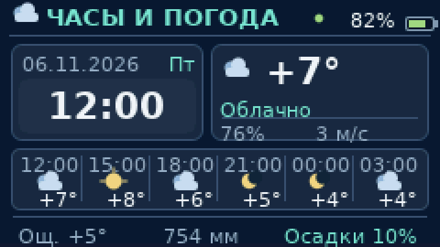
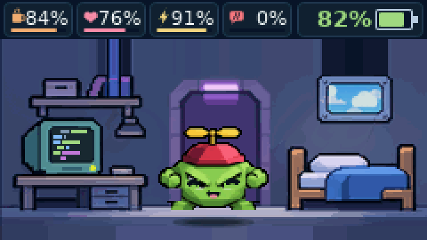

# Режим двух экранов · эксперимент 0.42

Прошивка **0.42-dashboard-test** для Heltec T114. Дисплей ST7789 — **240 × 135**. Пара с Android `0.19-test` использует совместимый протокол `D|3` с одним дополнительным полем.

## Как устроено пробуждение

1. **Экран погашен.** Первое нажатие физической кнопки только пробуждает дисплей. Сразу появляются **крупные часы, дата и погода**. Нажатие не открывает игровое меню, не кормит питомца и не выполняет другие действия.
2. **Экран включён, видны часы.** Следующее короткое нажатие показывает комнату и питомца.
3. **На экране питомец.** Короткое нажатие снова открывает часы/погоду, дальше экраны переключаются по кругу.
4. **Меню действий.** Долгое нажатие (примерно 0,6 секунды) на любом домашнем экране открывает выдвижную панель; короткое листает пункты, долгое выбирает. Удержание (около 2 секунд) закрывает меню / возвращает к питомцу.

Если ничего не нажимать **30 секунд**, дисплей T114 может погаснуть по прежнему правилу энергосбережения (когда игра не требует держать его включённым). Следующее физическое пробуждение снова начинается с часов и погоды.

Уведомления, будильник, эволюция и другие специальные игровые сцены **сохраняют свои приоритеты**: обычное нажатие пробуждения в таких режимах не должно подменять критические экраны информером.

## Что изменилось в оформлении

- На экране **питомца** часы и цифровая табличка температуры убраны. Четыре шкалы (сытость, настроение, энергия, дисциплина) получили больше пространства. Батарея остаётся видимой, погодные эффекты **за окном** сохраняются.
- Экран **«Часы и погода»** показывает дату, крупное время, температуру, погодное состояние, индикатор точности синхронизации и заряд батареи.
- Погода поступает **со смартфона по Bluetooth**; если данных нет или их срок истёк, вместо выдуманного прогноза выводится «Нет данных». Прямого интернет-запроса с платы нет.
- Выбор экранов не записывается в структуру `Save v4`, поэтому сохранения прошлой версии остаются совместимыми. После обычного перезапуска интерфейс начинается с комнаты; после отключения дисплея кнопка открывает часы.
- Android-зеркало получает дополнительное поле в конце состояния: `D|3` поле с индексом `54`. Предыдущие 54 поля не меняют порядок. Старые пакеты поддерживаются.

## Кадры непосредственно из графического ядра

**Первое нажатие при погашенном дисплее — часы и погода**

**Второе нажатие — питомец и увеличенные показатели**

Это точные кадры C++ `Game::render()` (исходное разрешение 240 × 135, PNG 720 × 405 без сглаживания), а не нарисованные концепты.

## Проверка

- `sim/features_test.cpp`: переход из пробуждения в информер, следующее нажатие, меню, энергосберегающий таймер, совместимость сохранений и BLE-пакетов.
- `.github/workflows/build.yml`: сборки прошивки T114 и Android APK, тесты логики.
- `.github/workflows/real-screenshots.yml`: создание кадров настоящим рендерером.

**Статус:** экспериментальная прошивка. Перед установкой на физическую плату сделайте резервную копию питомца. До проверки на устройстве не переносите изменение в стабильную ветку `main`.
