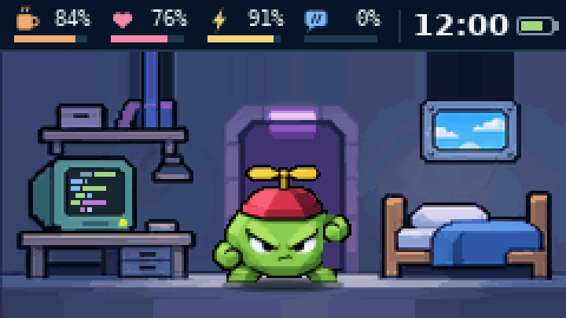

# 🐣 Жизнь Бита: игровой процесс

**Бит** — виртуальный программист, чьё состояние развивается со временем. Это не просто набор анимаций: у питомца есть характеристики, характер, привычки, стадии взросления, случайные события и достижения.

> Документ описывает экспериментальную связку **прошивка 0.41-sync-test + Android 0.19-test**, содержащуюся в данном снимке проекта. Прежде чем прошивать устройство, сохраните резервный код питомца.

## ⏳ Один день из жизни

| Событие | Что происходит |
|---|---|
| **Бит просыпается** | В комнате меняется освещение, питомец движется и реагирует на своё состояние |
| **Пора перекусить** | Можно выбрать кофе, пиццу или печенье. У каждого варианта собственный игровой эффект |
| **Мини-игра** | Победа влияет на показатели питомца и статистику |
| **Код-ревью** | Воспитание и дисциплина влияют на дальнейшее развитие |
| **Появились баги** | Их нужно убрать; накопление проблем отражается на питомце |
| **Время отдыхать** | При наступлении времени сна Бит укладывается в кровать; комната темнеет |

Смена игрового освещения привязана к часу: **рассвет с 05:00, утро с 08:00, день с 11:00, закат с 17:00, вечер с 19:00, ночь с 21:00**. Сам график сна различается между формами.

## ❤️ Что нужно контролировать

**Сытость** — уменьшается с течением времени. У разных видов пищи разный эффект: кофе поддерживает энергию, пицца сильнее насыщает, печенье поднимает настроение.

**Настроение** — влияет на реакции и просьбы питомца. Бит не всегда одинаково ведёт себя при хорошем и плохом настроении.

**Энергия** — расходуется при активности и восстанавливается во сне. Питомец может задремать, если устал.

**Дисциплина** — развивается через взаимодействия и обучение. От неё и ошибок ухода зависят некоторые исходы эволюции.

Отдельно существуют **здоровье, вес, баги, монеты, достижения, возраст, шаги и история поколений**.

## 🎭 Пять характеров

| Характер | Особенность |
|---|---|
| **Обжора** | Быстрее голодает, но получает больше сытости от еды |
| **Непоседа** | Быстрее скучает, но сильнее радуется играм |
| **Соня** | Быстрее устаёт, зато быстрее высыпается |
| **Умник** | Получает больше дисциплины от код-ревью |
| **Спокойный** | Медленнее теряет настроение |

Характер выбирается игрой и может влиять на поведение. При смене поколения часть особенностей может наследоваться.

## 🧬 Одиннадцать форм

Всего: **Компиляция, Hello World, Джун, Мидл, Фрилансер, Сеньор, Архитектор, Хакер, Легаси, Нейросеть и Призрак**.

В экспериментальной логике 0.41 базовые сроки следующие:

- Компиляция → Hello World: **10 минут**
- Hello World → Джун: **12 часов**
- Джун → взрослая развилка: **7 суток**
- Мидл / Фрилансер → более старшая форма: **10 суток**
- Архитектор / Хакер → возможная Нейросеть: **14 суток** при дополнительных условиях

Срок отсчитывается **от начала соответствующей стадии**, а переходы зависят от состояния и ухода. Не все стадии образуют прямую линейную цепочку.

## 🕹 Шесть мини-игр

| Игра | Механика |
|---|---|
| **Отладка** | Попасть в правильный момент по движущейся области |
| **Память** | Запомнить и повторить последовательность битов |
| **Деплой** | Перепрыгнуть баги на бегущем фоне |
| **Пинг** | Согласовать момент нажатия с индикатором |
| **Компиляция** | Остановить индикатор в зоне успешной сборки |
| **Реакция** | Нажать после появления сигнала |

Победы, игры и активность учитываются в статистике питомца. У каждого Бита может быть любимая игра.

## 🏆 Достижения и магазин

Реализованы **18 достижений**: за прогулки, уход, игры, сбор форм, новые знакомства, посещение мест и другие события. Некоторые достижения дают особые награды.

В магазине можно купить **шапку с помпоном, кепку, цилиндр, ковбойскую шляпу, колпак волшебника, кошачьи ушки** и темы оформления **Dracula, Monokai, светлую тему и Matrix**.

## 🌦 Комнаты, погода и праздники

Каждая форма живёт в собственной комнате. Окно отображает время суток и погодные условия, если данные переданы игре. В праздники могут появляться тематические украшения: например, ёлка, тыква или торт.

В прошивке **0.41** фон комнаты использует большую часть доступной высоты дисплея 240 × 135. Нижнее меню выдвигается поверх изображения по кнопке.

## 📍 Прогулки, GPS и встречи

GPS L76K используется для времени, данных прогулки, мест и заданий. Если включены LoRa-встречи и рядом находится другая совместимая T114, питомцы могут обнаруживать друг друга; в игре есть гости, возможность угощения и дуэли.

Не все функции доступны без соответствующего аппаратного оснащения, сигнала GPS и второго устройства.

## 📲 Android-компаньон

Приложение получает по Bluetooth игровое состояние и показывает питомца с использованием общего C++-графического ядра. Оно дополняет физическую T114 и не заменяет внутреннее хранение игрового состояния.

В экспериментальной паре **0.41 / 0.19** добавлена передача состояния выдвижного меню: открытость, выбранный значок и фаза анимации. Синхронизация при опросе BLE не мгновенная: между кадрами телефона и платы возможны небольшие задержки.

## 🔍 Что подтверждено, а что ещё нужно протестировать

- **Подтверждено по исходникам и CI:** игровые состояния, описанные выше, генерация точных кадров 0.41, сборка прошивки и APK, симуляционные тесты.
- **Требует проверки на устройстве:** автономность, внешний вид при реальном освещении дисплея, стабильность BLE/OTA, все комбинации аксессуаров и комнат.
- **Отдельно нужны:** настоящие скриншоты Android 0.19; пока в галерее находятся только кадры графического ядра прошивки.

[Вернуться к главной странице](../README.md) · [Посмотреть кадры](SCREENSHOTS.md) · [Установить](INSTALL.md)
