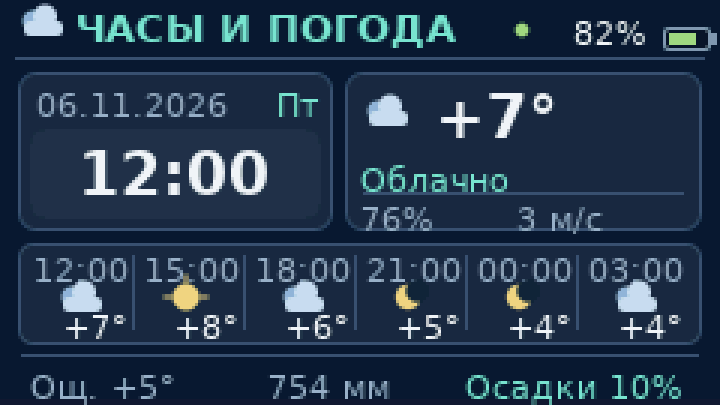
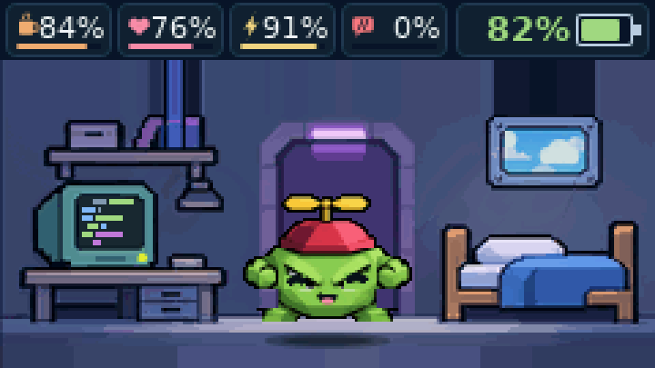

# Часы и погода 0.43 — расширенный пиксельный экран

Экспериментальная ветка: `experiment/rich-weather-dashboard-0.43`.

## Управление

- **Погашенный экран → первое нажатие:** разбудить T114 сразу на экране часов и погоды.
- **Второе короткое нажатие:** вернуться к питомцу.
- **Следующие короткие:** переключать два домашних экрана.
- **Долгое (~0,6 с):** открыть выдвижное игровое меню. **Удержание (~2 с):** закрыть меню / назад.

## Выбранное оформление

Композиция ориентирована на плотный pixel-art dashboard, адаптированный для **реальных 240×135 пикселей** ST7789 (макет с большой часовой панелью слева, погодой справа, прогнозом и служебными метриками).

- Верх: часы, дата и день недели, заряд батареи, индикатор синхронизации времени.
- Справа: температура, состояние погоды, влажность и ветер.
- Ниже: 6 прогнозных слотов через 3 часа — иконка и температура каждого.
- В подвале: «Ощ.», давление (мм рт. ст.) и вероятность осадков.

Оба PNG генерируются **из настоящего C++ рендерера**, а не из сторонней иллюстрации. В screenshot fixture использованы **примерные тестовые значения** +7°C, 76%, 3 м/с, 754 мм и 10%; в реальной прошивке они не захардкожены.

## Откуда берутся данные

Android **0.20-weather-test** получает погоду с **Open-Meteo** для города, выбранного в настройках приложения. В запросе используются текущая температура, WMO-код состояния, влажность, скорость ветра (м/с), ощущаемая температура, давление и почасовые температура/код/вероятность осадков.

BLE остаётся текстовым и обратно совместимым:

- `погода <тип> <температура>` — старый поддерживаемый формат, доступен 0.41/0.42.
- `wx <влажность> <ветер> <ощущается> <давление_мм> <осадки>` — новая короткая команда.
- `fc <кол-во> <часы> <температура> <тип> ...` — до шести прогнозных точек.

Новые команды Android отправляет **только после подтверждения прошивки 0.43**. Если данные отсутствуют, они не заменяются придумками: показывается текст об отсутствии прогноза; недоступные показатели просто пропускаются. Срок годности погоды в памяти платы — не больше трёх часов. Прогноз не сохраняется во флеш-память и не меняет `Save v4`.

**Ограничения:** T114 не получает погоду через Интернет самостоятельно. Нужны телефон с Интернетом, заданным городом и Bluetooth-соединением. Данные и частота обновления зависят от Open-Meteo и работы Android. Числа/стиль на созданном ранее художественном концепте не являются обещанием наличия всех полей на устройстве.

## Статус

Это тестовая сборка. До переноса в `main` требуется проверка на физической T114 и проверка переноса APK поверх прежней тестовой подписи.
